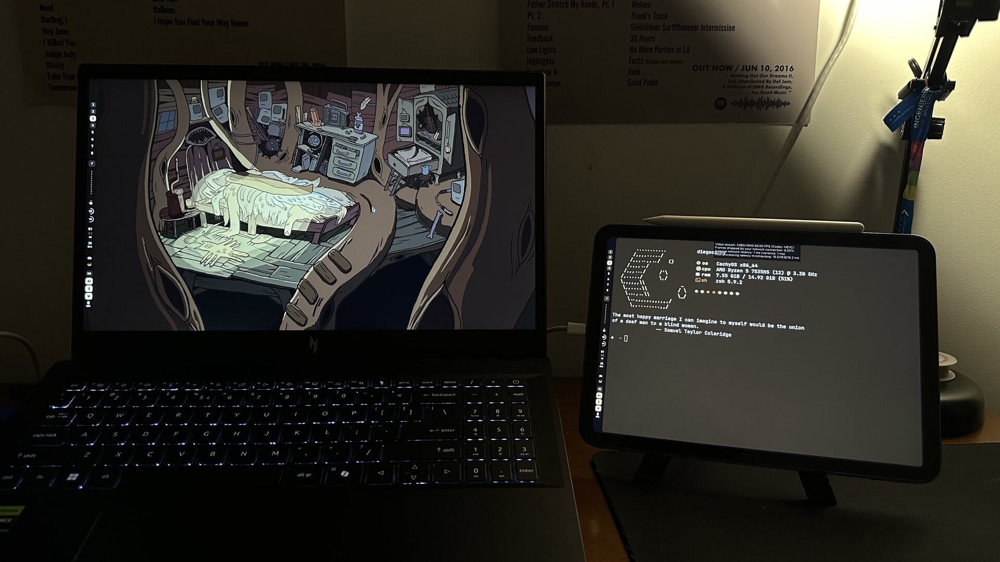
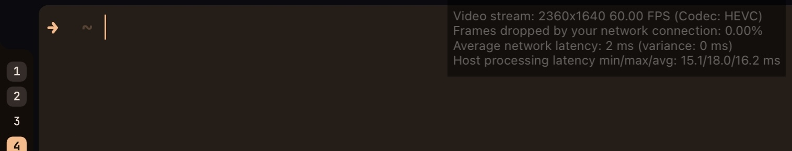

# iPad Virtual Monitor

Use an iPad as a **second, extended display** on Linux over a single USB-C cable.

No Wi-Fi, no cloud, no dongles. The iPad is not a physical monitor: the host
creates an extra virtual output, Sunshine encodes it, and Moonlight on the iPad
displays it. The same cable carries both the video stream and a private USB
network between the two devices.

```text
        Linux host                                      iPad
┌────────────────────────┐      USB-C / CDC-NCM      ┌──────────────┐
│  MOONLIGHT (virtual output) │                           │              │
│  Sunshine              │──── H.264 / HEVC  ──────► │  Moonlight   │
│  10.42.0.1             │◄─── mouse / keyboard ──── │  10.42.0.x   │
└────────────────────────┘      DHCP / 10.42.0.0/24  └──────────────┘
```



*One cable. The iPad is an extended desktop, not a mirror: workspace 4 lives on
it, with its own windows and its own cursor.*

Moonlight's statistics, on that same session:



`2 ms` is the network hop, and it stays there because there is no Wi-Fi in the
path: the frame never leaves the cable. The host side is the time Sunshine needs
to grab, encode and send each frame.

## How it works

Four layers, each one useless without the next:

1. **USB link** — Apple devices expose a CDC-NCM network interface only in the
   right USB device mode. `usbmuxd` requests that mode.
2. **Network** — NetworkManager turns the USB interface into a shared network
   and hands the iPad an address over DHCP. The firewall must allow it.
3. **Display** — the compositor creates a virtual output that behaves like a
   real second monitor.
4. **Stream** — Sunshine captures that output and serves it to Moonlight over
   the USB network.

The details of each layer live in [docs/](docs/).

## Requirements

| Component | Notes |
|-----------|-------|
| Linux with systemd | Tested on CachyOS (Arch-based) |
| `git` | The installer downloads the tool and, if needed, the USB stack with it |
| Wayland compositor | Hyprland is the first supported target |
| NetworkManager | Used to share the USB interface |
| `usbmuxd` with NCM support | Distro packages cannot switch the USB mode; `ivm deps` detects it and can build the stack |
| Sunshine | Host-side streaming server |
| Moonlight | iPad app, from the App Store |
| USB-C cable | Must support data, not just power |
| Optional: UFW | Only configured when it is active |

## Documentation

- [Architecture](docs/architecture.md) — how the pieces fit together
- [Dependencies](docs/dependencies.md) — why the distro package is not enough
- [USB network](docs/usb-network.md) — from cable to DHCP lease
- [Video pipeline](docs/video-pipeline.md) — virtual output and capture
- [Hyprland setup](docs/hyprland-setup.md) — what to add to your dotfiles
- [Troubleshooting](docs/troubleshooting.md) — symptom → cause → fix
- [Roadmap](docs/roadmap.md) — what is done and what comes next

## Credits

The USB networking approach is inspired by
[hkfuertes/virtual-screen](https://github.com/hkfuertes/virtual-screen), which
documents the `usbmuxd` device mode and the NetworkManager shared connection.
That guide targets X11; this project adapts the idea to Wayland.


## Status

**Early development.** The repository is being built phase by phase; see
[docs/roadmap.md](docs/roadmap.md).

- `ivm up` — prepares the host: starts Sunshine, points its prep hook at the
  tool, installs and starts the supervisor.
- `ivm status` — one short screen with the state of every layer.
- `ivm down` — removes the output and stops the supervisor.
- `ivm net` — reports the USB network, sets it up, or takes it down. It needs
  root for the network itself, so it prints every command and asks once.
- `ivm deps` — inspects the Apple USB stack, or builds it from source when the
  distribution package cannot switch the iPad's USB mode.
- `ivm doctor` — read-only, no root, walks all four layers and explains failures.
  `--report` turns that into a sanitized report you can paste into an issue.
- `ivm display` — create, remove and inspect the virtual output by hand.
- `ivm watch` — removes the output when the stream ends.
- `ivm completion` — prints a completion script for bash, zsh or fish.

## Install

One command. It runs as your user, prints its plan first, and asks once:

```bash
curl -fsSL https://raw.githubusercontent.com/diegostrg/ipad-virtual-monitor/main/install.sh | bash
```

It does five things:

1. downloads the tool into `~/.local/share/ipad-virtual-monitor` and links `ivm`
   into `~/.local/bin`;
2. builds the Apple USB stack if it is missing (5 to 10 minutes, needs network);
3. installs Sunshine when your package manager has it;
4. sets up the USB network and the firewall rule for it;
5. prepares the streaming host and the supervisor.

Every step is skipped when it is already done, so running it twice is boring.
It never runs as root: the privileged steps call `sudo` one command at a time,
after you have seen them. Plug the iPad in before the first run if you can,
because the network step needs the device; without it the installer does
everything else and tells you to run it again with the cable connected.

If you would rather read it before trusting it:

```bash
curl -fsSLO https://raw.githubusercontent.com/diegostrg/ipad-virtual-monitor/main/install.sh
less install.sh
bash install.sh --dry-run    # the plan, printed and nothing else
bash install.sh
```

`--dry-run` is available from any checkout too, and it changes nothing.

## Usage

```bash
ivm up        # prepare the host
ivm status    # where things stand
ivm doctor    # walk every layer when something is wrong
```

Then connect from Moonlight. `status` and `doctor` are read-only: run them as
often as you like.

```text
ivm status 0.1.0-dev
  host         CachyOS, hyprland 0.56.2
  network      usb0 10.42.0.1/24, iPad at 10.42.0.42
  sunshine     running, capturing with wlr
  prep hook    [{"do":"/home/you/ipad-virtual-monitor/bin/ivm display prep"}]
  display      absent (created when a client connects)
  supervisor   running

Idle. Connect from Moonlight and the output appears on its own.
```

### What `ivm up` changes

It is the only command that writes anything outside the compositor, and it says
so line by line:

- starts the Sunshine user service if it is not running;
- sets `capture = wlr` and the `global_prep_cmd` hook in the Sunshine
  configuration, keeping a timestamped backup next to it — credentials and
  pairing data are never read or touched;
- installs, enables and starts the supervisor's user unit.

It never asks for root. Anything that needs it is printed as the command to run.
`ivm down` undoes the runtime state (output removed, supervisor stopped) but
leaves the configuration alone, so the next `ivm up` is instant.

### The Apple USB stack

The distribution's `usbmuxd` cannot switch the iPad into the USB mode that
exposes its network interface: the feature landed upstream in December 2022 and
no release has been cut since. `ivm` detects that, and it can build the stack
for you:

```bash
ivm deps status            # read-only: tools, libraries, daemon, service
ivm deps build --dry-run   # print every command, change nothing
ivm deps build             # print the plan again, ask once, then build
```

`build` clones the six projects into `~/src/ivm-deps`, builds them in the
documented order, installs into `/usr/local`, writes the systemd drop-in for
`USBMUXD_DEFAULT_DEVICE_MODE=3` and restarts the daemon. It needs network access
and `sudo` for the installations; nothing runs before you see it. Re-running
continues from what is already built, and `--force` rebuilds after upstream
changes.

The manual recipe, the versions the reference machine was built with, and the
uninstall steps are in [docs/dependencies.md](docs/dependencies.md).

### The USB network

The link itself needs no setup once the machine has it: NetworkManager brings the
shared network back every time the iPad appears, even across reboots. What can
still be wrong is its configuration, and that is what `ivm net` looks at.

```bash
ivm net status              # read-only: link, address, profile, DHCP, firewall
ivm net up --dry-run        # the plan, without running anything
ivm net up                  # show the plan, ask once, then apply it
ivm net down                # deactivate the shared connection
```

```text
ivm net status 0.1.0-dev

Link
  ok   Apple device on the USB bus (product id 12ab)
  ok   data interface: usb0

Address
  ok   usb0 has 10.42.0.1/24 (network 10.42.0.0/24)
  ok   the iPad is at 10.42.0.42, answering in 1.85 ms

NetworkManager
  ok   'iPad-USB-Tethering': shared IPv4, no IPv6, autoconnect
  ok   'iPad-USB-Tethering' is active on usb0
  ok   usb1 is unmanaged, and stays so after a reload

DHCP
  ok   a DHCP server is listening on UDP/67
  ok   ufw allows DHCP in on usb0 (saved ruleset)
```

`ivm net up` only touches what is wrong. On a machine that already works it has
nothing to do and says so; when something is missing it explains the change
first:

```text
  plan sudo nmcli connection modify iPad-USB-Tethering ipv4.method shared ...
  plan sudo tee /etc/NetworkManager/conf.d/99-ivm-usb.conf
       [keyfile]
       unmanaged-devices=interface-name:usb1
  plan sudo ufw allow in on usb0 to any port 67 proto udp

Apply 3 command(s) with sudo? [y/N]
```

It never removes anything you configured and never changes the firewall beyond
one rule scoped to the USB interface. `--yes` skips the question for scripts;
without a terminal it refuses to apply anything at all.

### Diagnosing

When something is wrong, `ivm doctor` walks the four layers in dependency order
and the first `fail` is the one to fix:

```text
ivm doctor 0.1.0-dev

Host
  distro         CachyOS
  compositor     Hyprland 0.56.2, lua configuration
  session        wayland-1
  output         MOONLIGHT (side: right)

Layer 1 — USB device
  ok   iPad on the USB bus (product 12ab)
  ok   network interfaces exposed: usb0,usb1
  ok   usbmuxd is running
  ok   usbmuxd supports USB device mode 3

Layer 2 — USB network
  ok   usb0 has 10.42.0.1/24
  ok   NetworkManager connection: iPad-USB-Tethering
  ok   a DHCP server is listening on UDP/67
  ok   peer 10.42.0.42 answers in 1.67 ms
  ok   usb1 is unmanaged (Apple private interface, correctly ignored)
  warn ufw is active; the DHCP rule cannot be verified without root

Layer 3 — Virtual output
  ok   no Hyprland configuration errors
  ok   no leftover virtual outputs
  ok   MOONLIGHT exists: 2360x1640@60.00000 at 1920x0
  ok   MOONLIGHT touches another output (pointer can reach it)
  ok   Sunshine captures MOONLIGHT
  ok   Sunshine has a prep command configured

Layer 4 — Stream
  ok   Sunshine is running (pid 4578)
  ok   capture backend is wlr
  ok   encoders available: Found H.264 encoder: h264_vaapi [vaapi],Found HEVC encoder: hevc_vaapi [vaapi]
  ok   every Sunshine port listens on all interfaces
  ok   a session is running: session::audio session::video video::capture

Summary  19 ok, 2 warnings, 0 failures
Usable, but the warnings above are worth fixing.
```

The report is ordered by dependency: the first `fail` is the one to fix, because
everything below it is a precondition. Exit codes: `0` no failures, `1` at least
one layer is broken, `2` bad usage.

Add `--verbose` for paths and commands behind each check.

### Reporting a bug

`ivm doctor --report` runs the same survey and prints it as plain text for an
issue. The report is always verbose and never coloured, and it is **sanitized**:
addresses, MACs, the hostname, your user name and home paths become `<ip>`,
`<mac>`, `<host>` and `<user>` placeholders. The shape survives, so `<ip>/24`
still says there is a subnet, and the person reading it gets the diagnosis
without your details.

```bash
ivm doctor --report            # copy what is between the two rules
```

Nothing is uploaded by the tool. It is for you to paste where you choose.

### The virtual output

```bash
ivm display status                 # what exists, and what would be created
ivm display create --dry-run       # print the plan, change nothing
ivm display create                 # create it at the size the client asked for
ivm display create --side left --width 1920 --height 1334
ivm display create --width 2360 --height 1640 --scale 1.6
ivm display remove
```

The size comes from, in this order: the flags, the request Moonlight sent to
Sunshine (`SUNSHINE_CLIENT_WIDTH/HEIGHT/FPS`), then the configuration file.
Positions are computed from your real layout so the new screen always touches an
existing one — a gap or an overlap looks like a working stream until the pointer
has to cross it.

The scale has one constraint that is easy to miss: Hyprland divides the mode by
it to get the layout size and needs whole pixels, so a scale that does not
divide both dimensions exactly is applied as an integer instead. `2360×1640` at
`1.6` is `1475×1025` and works; `1920×1334` at `1.6` is `833.75` and would become
`2`. `ivm` checks this before touching the compositor and falls back to `1.0`
with a message rather than let the layout drift, which means a scale is worth
pairing with the mode it divides.

Creating the output takes the focus away from what you were doing, so the tool
snapshots the focused monitor and the active window and puts them back.

### Keeping the desktop clean

Hyprland never removes the output by itself, and Sunshine has no disconnect
hook. `ivm watch` is the piece that closes the loop:

```bash
ivm watch                # foreground: removes MOONLIGHT 20 s after a disconnect
ivm watch --once         # reconcile right now and exit
```

`ivm up` installs it as a user service, so it survives a closed terminal and
starts with your session:

```bash
systemctl --user status ivm-watch
journalctl --user -u ivm-watch -f     # see the removals as they happen
```

To keep it by hand instead:

```bash
cp share/systemd/ivm-watch.service ~/.config/systemd/user/
systemctl --user daemon-reload && systemctl --user enable --now ivm-watch
```

The unit expects `ivm` on your `PATH`; adjust `ExecStart` if you prefer an
absolute path.

#### Why it also restarts Sunshine

Sunshine runs `global_prep_cmd` when it **launches the app** of a session, not on
every client connection, and the desktop app it streams is a placebo that never
exits. A Sunshine that is still running therefore believes the app is alive,
skips the prep on the next connection, finds no `MOONLIGHT`, and quietly streams
a clone of the laptop panel instead.

So when the supervisor removes the output, it also restarts Sunshine. With
nobody connected that costs a few seconds and arms the hook for the next
connection. Because that happens in the background, it warns you with a desktop
notification:

```text
Restarting Sunshine — Wait a few seconds before reconnecting from Moonlight.
```

It appears about two seconds *into* the restart, not before it: removing the
output makes Hyprland move the workspaces back to the laptop panel, and a popup
raised during that switch is sometimes swallowed. The delay runs in its own
process, so it never holds the restart up.

It uses `notify-send`, and it stays quiet if the tool or the notification daemon
is missing: this is a courtesy, not a dependency. `NOTIFY=no` in the config turns
it off.

`ivm status` and `ivm doctor` call out the clone explicitly if it ever happens,
because the stream itself looks perfectly healthy.

### Configuration

`ivm` reads `~/.config/ivm/config` if it exists. Every key is optional:

```ini
OUTPUT_NAME=MOONLIGHT   # name of the virtual output
SIDE=right              # right, left, above or below the laptop panel
WIDTH=1920              # fallback size when the client does not ask for one
HEIGHT=1334
FPS=60
SCALE=1.0               # layout scale, 0.5 to 4; must divide the size exactly
FOLLOW_CLIENT=yes       # prefer the size and rate Moonlight requests
GRACE=20                # seconds to wait before removing the output
NOTIFY=yes              # desktop notification before Sunshine is restarted
```

Values are validated and the file is parsed, never sourced.

The scale works best paired with the size it divides. For the 11-inch iPad and a
1.6 scale, the native frame is the one that fits:

```ini
WIDTH=2360
HEIGHT=1640
SCALE=1.6
```

With `FOLLOW_CLIENT=yes`, Moonlight's own resolution setting still wins, so
choosing *PC/Game resolution* there (`1920×1334`) drops the scale back to `1.0`
and says so. Choose *Full / Safe Area* to get the mode that carries `1.6`.

### Shell completions

`ivm completion` prints a script for the shell you name. They are plain text kept
with the source, so there is no generated file, no install hook and nothing to
rebuild.

```bash
# bash
ivm completion bash > ~/.local/share/bash-completion/completions/ivm

# zsh (the file must be named _ivm and its directory must be in $fpath)
mkdir -p ~/.zfunc
ivm completion zsh > ~/.zfunc/_ivm
# in ~/.zshrc, before compinit runs: fpath=(~/.zfunc $fpath)

# fish
ivm completion fish > ~/.config/fish/completions/ivm.fish
```

For the current session only, after `compinit` has run:
`eval "$(ivm completion zsh)"`, or `eval "$(ivm completion bash)"` in bash.


## License

MIT — see [LICENSE](LICENSE).
